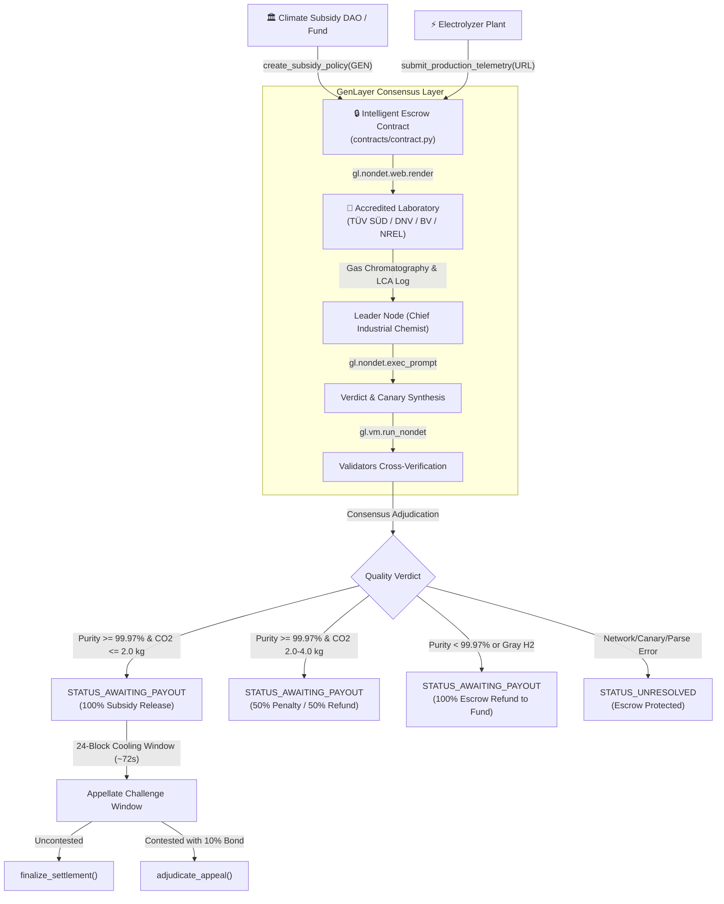

# ⚡ AgentGreenHydrogen — Protocol Architecture & System Design

**Autonomous Green Hydrogen Purity & Renewable Electrolysis Subsidy Escrow**  
**Target Network:** GenLayer StudioNet (Chain ID: `61999` / Hex `0xF22F`, RPC: `https://studio.genlayer.com/api`)  
**Core Standard:** ISO 14687:2019 Type I Grade D & EU RED III Clean Hydrogen Standard

---

## 🌐 1. Executive Summary & Problem Space

Green Hydrogen ($H_2$) produced via water electrolysis is central to the global decarbonization of heavy transport, aviation, and steel manufacturing. Under major regulatory frameworks such as the **EU Renewable Energy Directive III (RED III)** and the **US IRA 45V Clean Hydrogen Tax Credit**, hydrogen only qualifies for clean energy production subsidies if:
1. **Electrolyzer Electricity:** Matched on an hourly basis with 100% accredited renewable energy (wind, solar, or hydro) with zero fossil peaking fuel.
2. **Purity Compliance:** Gas output satisfies **ISO 14687:2019 Grade D** standards ($\ge 99.97\%$ purity), avoiding catastrophic degradation of PEM fuel cells.
3. **Carbon Intensity:** Lifecycle greenhouse gas footprint must remain strictly $\le 2.0\text{ kg CO}_2\text{e} / \text{kg } H_2$.

### The Dilemma
Conventional EVM blockchains cannot ingest, verify, or arbitrate real-time gas chromatography spectrums, mass spectrometry reports, or live Guarantees of Origin (GOs). As a result, fraudulent operators mix cheap fossil steam methane reforming (gray hydrogen) or grid electricity into their stacks while continuing to claim clean energy subsidies.

### The GenLayer Solution
**AgentGreenHydrogen** solves this by establishing a decentralized, parametric subsidy escrow on GenLayer StudioNet. An on-chain AI Tribunal powered by `gl.nondet.web.render` and `gl.vm.run_nondet` consensus inspects live laboratory spectrometry feeds and carbon intensity ledgers from registered, accredited auditing agencies (TÜV SÜD, DNV, Bureau Veritas, NREL). Subsidies are automatically paid, penalized, or refunded based on verifiable chemical and environmental facts.

---

## 🏛️ 2. Core Protocol Architecture

---

## 🔒 3. Smart Contract State Machine

The contract transitions across nine discrete states, preventing premature or erroneous disbursements:

| Status Code | Status Name | Description |
|---|---|---|
| `0` | `STATUS_POLICY_OPEN` | Climate Fund deposited GEN subsidy escrow; awaiting plant telemetry. |
| `1` | `STATUS_TELEMETRY_SUBMITTED` | Accredited gas chromatography and renewable certificates uploaded. |
| `2` | `STATUS_AWAITING_PAYOUT` | AI Jury rendered verdict; 24-block (~72s) dispute cooling-off active. |
| `3` | `STATUS_SETTLED_CERTIFIED_FULL` | ISO 14687 compliant green hydrogen confirmed; 100% subsidy released. |
| `4` | `STATUS_SETTLED_PARTIAL` | Carbon intensity breach / minor grid mixing; 50% penalty enforced. |
| `5` | `STATUS_SETTLED_REJECTED` | Gray hydrogen detected / purity failure; 100% refunded to climate fund. |
| `6` | `STATUS_DISPUTED` | Staked appellate review active with 10% bonded challenge. |
| `7` | `STATUS_EXPIRED_RECLAIMED` | Coverage window lapsed without telemetry; escrow reclaimed by fund. |
| `8` | `STATUS_UNRESOLVED` | Telemetry fetch, parse, or canary mismatch; funds remain safely locked. |

---

## 🛡️ 4. Security & Consensus Safeguards

1. **Anti-Hallucination Security Canary:**
   - Every leader and validator response must contain `CANARY_AGENT_GREEN_HYDROGEN_V1`.
   - Any response omitting or tampering with the canary automatically triggers `STATUS_UNRESOLVED`.

2. **Accredited Auditor Whitelisting:**
   - The contract verifies domain roots strictly against `ACCREDITED_HYDROGEN_AUDITORS`:
     - `tuvsud.com`, `dnv.com`, `bureauveritas.com`, `nrel.gov`, `certifhy.eu`, `energy.gov`, `fraunhofer.de`, `iso.org`.
   - Unauthenticated blog or fake telemetry URLs revert on-chain before consensus execution.

3. **Pull-Payment Pattern (`_safe_transfer` & `claim_payout`):**
   - In case outbound value transfers encounter receiver gas limits or contract fallback rejections, funds are buffered in `claimable_balances[recipient]`.
   - Beneficiaries can safely withdraw buffered balances via `claim_payout()`.

4. **Cooling-Off Period & Bonded Appeal:**
   - A 24-block (~72 seconds) challenge window allows either sponsor or plant to contest verdicts.
   - Requires a 10% staked dispute bond and bound accredited laboratory evidence.
   - Spurious appeals forfeit the bond to the counterparty.

---

## 💻 5. Frontend & Integration Stack

- **Framework:** React 18 + Vite + TypeScript
- **Styling:** TailwindCSS with Clean Industrial Teal & Graphite Palette
- **Web3 Connector:** Direct GenLayer RPC (`https://studio.genlayer.com/api`) & MetaMask integration
- **Real-Time Visualizer:** Gas chromatography absorption peak spectrum, hourly renewable attribution breakdown, and PEM fuel cell operating diagnostics.

---

## 👥 6. Role-Based Access Control (RBAC) & Permission Architecture

The protocol enforces deterministic role boundaries on-chain:

1. **Sponsor (Climate Fund / DAO):**
   - Can call `create_subsidy_policy` with native GEN escrow.
   - Disallowed from designating themselves as the electrolyzer plant (conflict of interest prevention).
   - Can file `appeal_verdict` with 10% bonded challenge during the 24-block window.
   - Can invoke `cancel_or_reclaim` once coverage duration concludes if no telemetry was submitted.
2. **Electrolyzer Plant (Hydrogen Producer):**
   - Strictly the only entity authorized to execute `submit_production_telemetry`.
   - Authorized to appeal adverse verdicts during the 24-block (~72s) cooling-off period.
   - Receives 100% or 50% subsidy releases upon certified adjudication.
3. **Appellant (Dispute Initiator):**
   - Any authorized stakeholder who stakes a 10% dispute bond with bound laboratory spectrometry data.
   - Forfeits bond to counterparty if appeal is dismissed; receives full refund if upheld.
4. **Protocol Owner / Admin:**
   - Contract deployer providing fallback maintenance; cannot arbitrarily liquidate escrowed capital.
5. **Independent AI Tribunal / GenLayer Consensus:**
   - Multi-perspective consensus magistrate executing across validators without centralized human keys.

