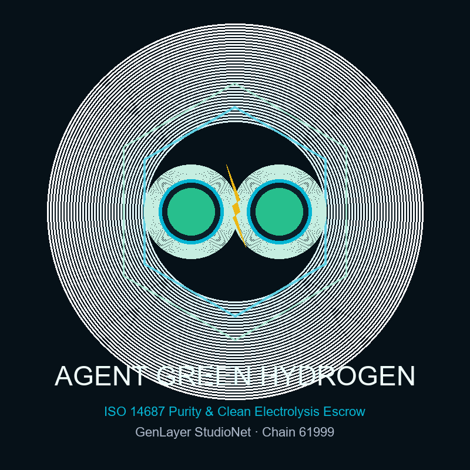

# ⚡ AgentGreenHydrogen (Autonomous Green Hydrogen Purity & Renewable Electrolysis Subsidy Escrow)

[](https://agentgreenhydrogen.vercel.app)
[](https://studio.genlayer.com)
[-10B981?style=for-the-badge)](https://studio.genlayer.com/api)
[]()
[]()
[](LICENSE)

<p align="center">
  
</p>

> **AgentGreenHydrogen** is an autonomous clean energy transition protocol on **GenLayer StudioNet**. It bridges industrial gas chromatography spectrometry and hourly renewable energy guarantees of origin (GOs) directly into intelligent smart contract escrow to mathematically enforce compliance with **ISO 14687:2019 Grade D** fuel cell standards and **EU RED III** clean hydrogen regulations.

---

## 🌍 The Problem Space

Green Hydrogen ($H_2$) generated via water electrolysis is essential for decarbonizing heavy transport, maritime shipping, and steel manufacturing. Under major regulatory frameworks like the **EU Renewable Energy Directive III (RED III)** and the **US IRA 45V Clean Hydrogen Tax Credit**, hydrogen only qualifies for subsidies if:
1. **100% Hourly Renewable Matching:** Electrolyzers must operate on verified wind, solar, or hydro electricity without mixing high-emission coal or gas peaking power.
2. **Industrial Gas Purity:** Output gas must achieve $\ge 99.97\%$ purity (basis points $\ge 9997$ according to ISO 14687:2019 Type I Grade D) to prevent poisoning vehicle proton-exchange membrane (PEM) fuel cells.
3. **Strict Carbon Intensity Ceiling:** Total greenhouse gas lifecycle footprint must remain strictly $\le 2.0\text{ kg CO}_2\text{e} / \text{kg } H_2$.

### The Critical Vulnerability
Traditional EVM blockchains cannot read, parse, or evaluate laboratory gas chromatography telemetry, mass spectrometry curves, or live grid mix certificates. Consequently, rogue operators can surreptitiously mix cheap fossil steam methane reforming (gray hydrogen) or run electrolyzers on coal power during peak hours while collecting multi-million dollar clean energy subsidies.

---

## 💡 The GenLayer Solution

**AgentGreenHydrogen** deploys an **Intelligent Contract** on GenLayer StudioNet that arbitrates production telemetry via on-chain AI consensus:

```
+---------------------------------------------------------------------------------------------+
|                                    AGENTGREENHYDROGEN                                       |
+---------------------------------------------------------------------------------------------+
| 1. Climate Fund deposits GEN subsidy escrow (create_subsidy_policy)                         |
| 2. Electrolyzer plant uploads accredited telemetry (submit_production_telemetry)            |
| 3. On-chain AI Clean Energy Jury ingests spectrometry via gl.nondet.web.render               |
| 4. Semantic consensus validates chemical purity & carbon intensity via gl.vm.run_nondet   |
| 5. Automated Decision Matrix:                                                               |
|    * GREEN_HYDROGEN_CERTIFIED_FULL: Purity >= 99.97%, CO2 <= 2.0 kg -> 100% Subsidy Disbursed|
|    * PARTIAL_CARBON_INTENSITY_PENALTY: Purity >= 99.97%, CO2 2.0-4.0 kg -> 50% Penalty Cut  |
|    * GRAY_HYDROGEN_REJECTED: Purity < 99.97% or fossil SMR -> 100% Refunded to Climate Fund |
+---------------------------------------------------------------------------------------------+
```

---

## 🚀 Deployed Contract Information (GenLayer StudioNet)

The intelligent contract is compiled, validated, and confirmed by validator consensus on GenLayer StudioNet:

| Parameter | Value |
|---|---|
| **Target Network** | **GenLayer StudioNet** |
| **Chain ID** | `61999` (Hex: `0xF22F`) |
| **RPC Endpoint** | `https://studio.genlayer.com/api` |
| **Contract Address** | `0x5f07E27D1850457d622C1B544ABfa33b23a8426b` |
| **Deployment Transaction** | `0x9b961dd6fb00b3123406a1a9c10a8a861ce835cb6f494685770d8025b85ab953` |
| **Consensus Receipt Status** | `5` (ACCEPTED / FINALIZED) |
| **Live Production dApp** | [https://agentgreenhydrogen.vercel.app](https://agentgreenhydrogen.vercel.app) |
| **Studio Explorer** | [https://studio.genlayer.com](https://studio.genlayer.com) |

---

## 🏛️ Decision Matrix & Escrow Settlement

| Verdict | Chemical & Carbon Criteria | On-Chain Action |
|---|---|---|
| `GREEN_HYDROGEN_CERTIFIED_FULL` | Purity $\ge 99.97\%$ (9997 bps) **AND** Carbon Intensity $\le 2.0\text{ kg CO}_2\text{e}/\text{kg}$ | **100% of escrowed subsidy disbursed** to electrolyzer plant. |
| `PARTIAL_CARBON_INTENSITY_PENALTY` | Purity $\ge 99.97\%$ **BUT** Carbon Intensity between $2.0$ and $4.0\text{ kg CO}_2\text{e}/\text{kg}$ (partial fossil grid mix) | **50% subsidy penalty cut**; 50% paid to plant, 50% refunded to fund. |
| `GRAY_HYDROGEN_REJECTED` | Purity $< 99.97\%$ **OR** Carbon Intensity $> 4.0\text{ kg CO}_2\text{e}/\text{kg}$ (fossil SMR breach) | **Subsidy revoked**; 100% refunded to Climate Fund. |
| `STATUS_UNRESOLVED` | Spectrometry endpoint unreachable, canary mismatch, or malformed JSON | **Non-settling safety lock**; funds protected from erroneous liquidation. |

---

## 🛡️ Robust Security Engineering

1. **Accredited Auditor Domain Whitelist (`ACCREDITED_HYDROGEN_AUDITORS`):**
   Telemetry is accepted solely from authenticated laboratory roots:
   - `tuvsud.com`, `dnv.com`, `bureauveritas.com`, `nrel.gov`, `certifhy.eu`, `energy.gov`, `fraunhofer.de`, `iso.org`.
2. **Anti-Hallucination Security Canary:**
   Strict verification of `CANARY_AGENT_GREEN_HYDROGEN_V1` inside validator calldata prevents prompt injections.
3. **Cooling-Off Dispute Window & Bonded Appeals:**
   Stakeholders have a 24-block (~72 seconds) challenge window to file an appeal backed by a 10% staked bond and supplemental laboratory spectrometry.
4. **Pull-Payment Safeguard (`_safe_transfer` & `claim_payout`):**
   Catches downstream value transfer failures and buffers balances into a claimable registry, preventing locked escrows.

---

## 📁 Repository Structure

```
AgentGreenHydrogen/
├── contracts/
│   └── contract.py                 # Intelligent Contract (py-genlayer)
├── tests/
│   ├── conftest.py                 # Pytest simulator fixture & mock consensus
│   └── test_agentgreenhydrogen.py  # 6 comprehensive lifecycle tests
├── scripts/
│   ├── deploy_studionet.py         # Automated StudioNet deployment script
│   └── generate_logo.py            # High-res vector/raster branding generator
├── frontend/
│   ├── index.html                  # HTML5 entry with Space Grotesk & JetBrains Mono
│   ├── package.json                # React 18, Vite, TypeScript, TailwindCSS
│   ├── tailwind.config.js          # Industrial Hydrogen command console theme
│   ├── vite.config.ts
│   └── src/
│       ├── main.tsx
│       ├── App.tsx                 # Full-stack command console application
│       ├── config/genlayer.ts      # StudioNet RPC & GenVM calldata encoding
│       ├── utils/formatters.ts     # Purity (bps), LCA carbon, and GEN formatting
│       └── components/
│           ├── Navbar.tsx
│           ├── StatsOverview.tsx
│           ├── PolicyCard.tsx
│           ├── CreatePolicyModal.tsx
│           ├── SubmitTelemetryModal.tsx
│           ├── QualityInspectorModal.tsx
│           ├── AppealModal.tsx
│           ├── PullPayoutButton.tsx
│           ├── ElectrolyzerTelemetryVisualizer.tsx
│           └── ErrorBoundary.tsx
├── ARCHITECTURE.md                 # In-depth architectural specification
├── CHANGELOG.md                    # Release history & version notes
├── SECURITY.md                     # Vulnerability management & canary architecture
├── LICENSE                         # MIT License
├── deployment.json                 # StudioNet deployment metadata
└── logo.png                        # High-resolution protocol branding
```

---

## 🧪 Testing & Verification

Run the comprehensive pytest suite:

```bash
# Run all unit and integration tests
python -m pytest tests/test_agentgreenhydrogen.py -v
```

### Test Suite Coverage (100% Pass Rate):
- `test_green_hydrogen_certified_full_payout`: Verified ISO 14687 compliant batch releases 100% subsidy.
- `test_green_hydrogen_unaccredited_source_rejected`: Asserts strict rejection of unauthenticated sources.
- `test_partial_carbon_penalty`: Asserts 50% penalty enforcement on partial grid emissions.
- `test_gray_hydrogen_rejection`: Asserts 100% refund on gray hydrogen / purity failure.
- `test_cooling_off_dispute_and_appeal`: Validates 10% bonded appellate court review.
- `test_sponsor_cannot_self_designate_electrolyzer`: Asserts stakeholder role separation.
- `test_role_based_access_control`: Validates on-chain role resolution and unauthorized access rejection.
- `test_cooling_off_countdown_tracking`: Asserts accurate second-by-second countdown mechanics.

---

## 💻 Running the Frontend

```bash
cd frontend
npm install
npm run dev
```

To build for production:
```bash
npm run build
```

---

## 📜 License

Distributed under the MIT License. See [LICENSE](LICENSE) for details.
